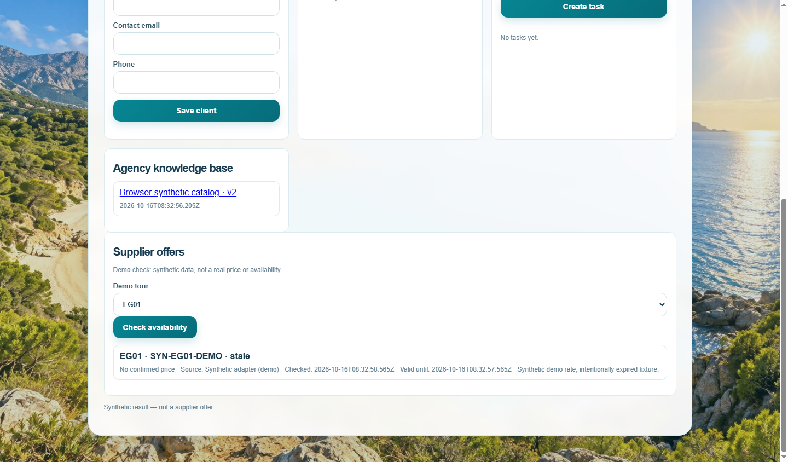
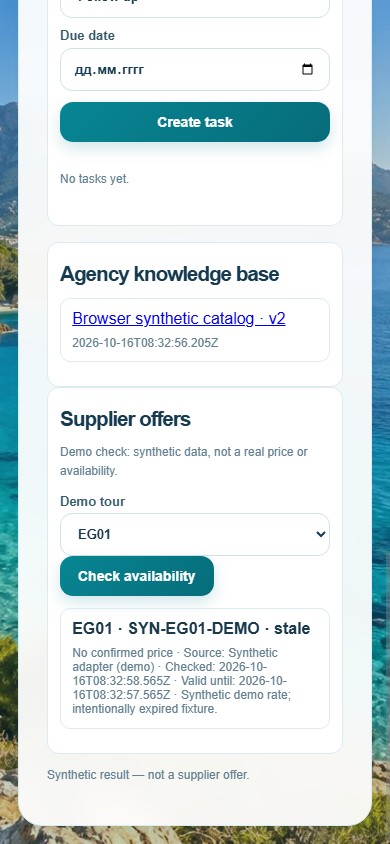

# AI Travel Agent — Agency Platform Showcase

A multilingual travel-agency platform prototype for exploring tours and supporting agency staff workflows. It combines a demo tour catalog, tenant-scoped customer and lead management, agency knowledge sources with citations, and a supplier-offer panel that makes the source and freshness of sample data visible.

> **Demo status:** A public Live Demo is being prepared. No public demo is available yet.

## What the prototype includes

- A catalog of 12 demonstration tours, with Russian, English, Spanish, and Brazilian Portuguese interface localization.
- Tenant-scoped agency accounts, memberships, and role-based access for clients, managers, and agency administrators.
- A minimal agency CRM for client records, leads, manager tasks, and links to existing demonstration requests.
- Versioned agency knowledge sources from PDF, DOCX, XLSX, CSV, TXT, and Markdown files, using lexical search and source citations. Search does not use vector embeddings.
- A supplier-offer interface that displays provenance, currency, check time, conditions, and freshness status.

## Screenshots

These captures come from the Stage 3.2D browser acceptance run on an isolated synthetic SQLite fixture. They show the supplier panel, not a live supplier integration.

### Desktop — supplier offer provenance

### Mobile — supplier offer provenance

## Technology

Node.js 20+, Express 5, SQLite as the local default store, and an optional PostgreSQL adapter with tenant isolation. The browser interface uses HTML, CSS, and JavaScript. Knowledge-file text extraction supports PDF, DOCX, XLSX, CSV, TXT, and Markdown; retrieval is lexical rather than embedding-based.

## Important limitations

- Supplier offers in this build are **synthetic test data only**. No real supplier is connected. Real-world prices and availability are not confirmed; sample values must not be treated as quotes.
- There is no booking or payment flow.
- Expired or unavailable offers are not presented as confirmed current prices or availability.
- The public Live Demo is still being prepared; the link will be added here after a separate review and deployment.
- Automated offline tests and browser checks cover defined local fixtures and application behavior. They are **not** production testing, a production security audit, a live AI quality assessment, or evidence of service availability.
- Knowledge search is lexical and does not include OCR or vector embeddings.

## Live Demo

**Coming soon — public deployment has not been created.**

---

This repository is a portfolio presentation of the AI Travel Agent project. It intentionally contains only this README and the reviewed screenshot assets; it does not include application source code, internal documentation, prompts, databases, credentials, or test scripts.